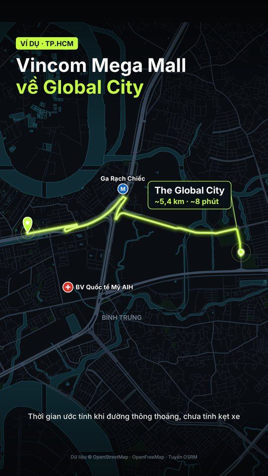
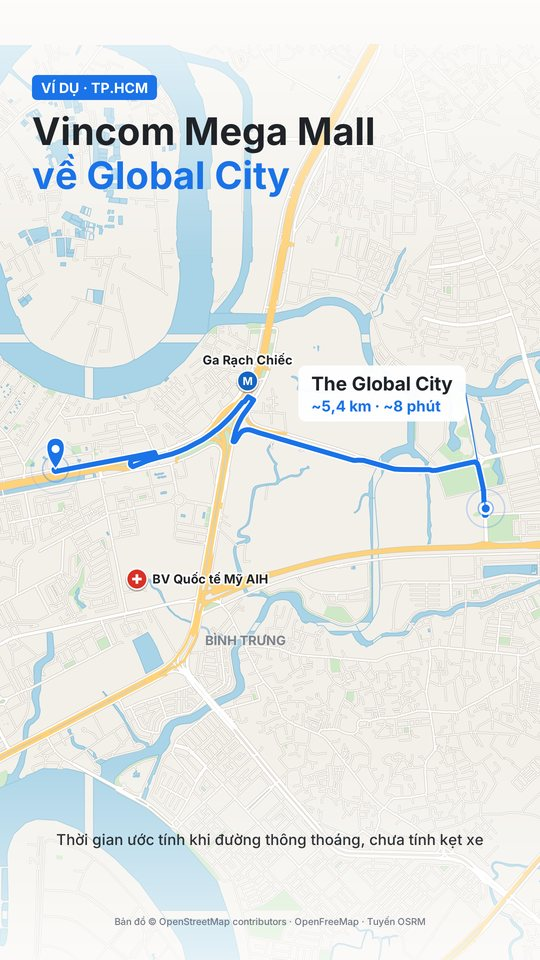

# map-route-video

Skill cho Claude để dựng video dọc 9:16 có bản đồ tuyến đường ở Việt Nam, và edit clip giới thiệu nhà của môi giới.

| Neon | Bản đồ OSM |
|---|---|
|  |  |

## Làm được gì
- Vẽ tuyến từ A đến B, camera bám theo, có ghim, nhãn km/phút và địa điểm nổi tiếng.
- Xuất 3 phong cách: neon tối, bản đồ sáng OpenStreetMap, ảnh vệ tinh do bạn cung cấp.
- Edit clip tự quay: phiên âm, cắt khoảng lặng, phụ đề, thẻ thông số, chèn cảnh bản đồ, bản so sánh trước/sau.

## Cài đặt
Tải file `.skill` ở mục Releases hoặc nén thư mục này, rồi thêm vào Claude. Với Claude Code, chép thư mục vào `~/.claude/skills/map-route-video/`.

Máy chạy cần Python 3, ffmpeg và `pip install pycairo mapbox-vector-tile pillow`. Phần edit clip cần thêm Node.js, `faster-whisper` và `numpy`.

## Giới hạn cần biết
- **Claude cần chạy được code và mở được nguồn bản đồ.** Nhiều môi trường chặn các nguồn này. Khi đó skill lấy dữ liệu qua trình duyệt, nên bản Claude chỉ chat sẽ không đủ.
- **Không kèm công cụ tải ảnh vệ tinh.** Bạn cần tự có ảnh được phép dùng. Không có thì dùng neon hoặc OSM.
- **Thời gian di chuyển là ước tính** từ OSRM, chưa tính kẹt xe.
- **Lớp quy hoạch không có sẵn.** Không có trong OpenStreetMap, và skill chưa có chế độ quy hoạch.

## Dữ liệu và giấy phép
Mã nguồn dùng giấy phép MIT (xem `LICENSE`). Giấy phép này không áp dụng cho dữ liệu bản đồ:
- Dữ liệu © [OpenStreetMap contributors](https://www.openstreetmap.org/copyright), giấy phép ODbL. Video phải giữ dòng ghi nguồn.
- [Chính sách dùng OSRM demo](https://github.com/Project-OSRM/osrm-backend/wiki/Api-usage-policy).
- [OpenFreeMap](https://openfreemap.org).
- Ảnh vệ tinh theo giấy phép của nguồn ảnh bạn dùng.

Bạn tự chịu trách nhiệm kiểm tra điều khoản nguồn dữ liệu và quyền dùng clip trước khi đăng.
