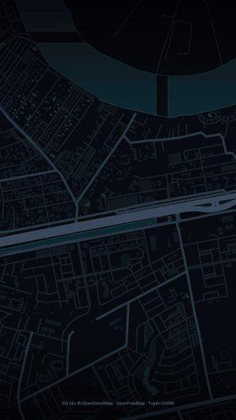
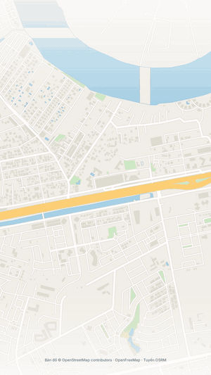
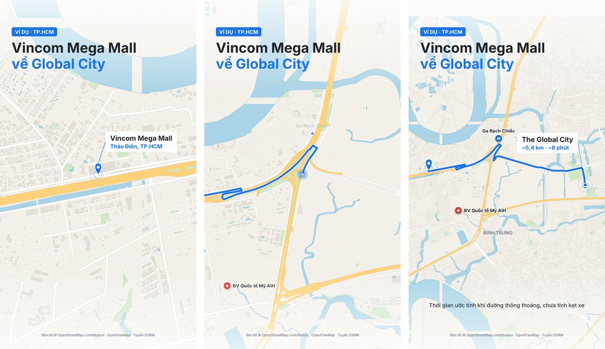

# Map Route Video — Video bản đồ tracking cho môi giới BĐS

**Skill cho AI giúp môi giới bất động sản tạo video dọc 9:16 (Reels/TikTok/Shorts) có bản đồ tuyến đường tự vẽ, và edit clip giới thiệu nhà tự quay.** Bạn chỉ cần nói điểm đi, điểm đến. AI lo phần tìm dữ liệu, dựng hình và xuất MP4.

Dùng được với các AI agent chạy được code và đọc được chuẩn `SKILL.md`, như Claude Code, Codex, Cursor, Gemini CLI. Với ChatGPT có chạy code, dùng [prompt dựng sẵn](references/prompt-chatgpt-hyperframes.md).


[](https://www.remotion.dev/docs/license/faq)


[](https://www.facebook.com/groups/1408241059869300/)

Nếu skill có ích, cho mình xin một ⭐ để nhiều anh chị trong nghề biết đến hơn nhé.

## Mục lục

- [Xem trước](#-xem-trước)
- [Vì sao có skill này](#-vì-sao-có-skill-này)
- [Tính năng nổi bật](#-tính-năng-nổi-bật)
- [Ba phong cách bản đồ](#-ba-phong-cách-bản-đồ)
- [Cấu trúc repo](#-cấu-trúc-repo)
- [Yêu cầu hệ thống](#-yêu-cầu-hệ-thống)
- [Bắt đầu](#-bắt-đầu)
- [Giới hạn cần biết](#-giới-hạn-cần-biết)
- [Đóng góp](#-đóng-góp)
- [Xem thêm](#-xem-thêm)
- [License](#-license)

## 🎬 Xem trước

| Neon tối | Bản đồ sáng |
| --- | --- |
|  |  |

Hai video dùng chung một tuyến và một chuyển động camera, chỉ đổi phong cách. GIF đã thu nhỏ để tải nhanh, bản MP4 thật là 1080×1920, 30 fps, dài 10 giây.

Mỗi video đi qua 3 nhịp: cận cảnh điểm xuất phát, vẽ tuyến với camera bám theo, rồi lùi ra toàn tuyến để hiện km và thời gian.



Tuyến mẫu: Vincom Mega Mall → The Global City. Dữ liệu từ OpenStreetMap, thời gian là ước tính của OSRM.

## 💡 Vì sao có skill này

Khách mua nhà hỏi đi hỏi lại mấy câu: nhà nằm đâu, ra đường lớn bao xa, về trung tâm mất bao lâu, xung quanh có gì? Gửi định vị thì khách lười mở, giải thích bằng chữ thì dài. Một video bản đồ 10 giây trả lời hết các câu đó, nhưng trước đây phải biết dựng video hoặc thuê người.

## 📌 Tính năng nổi bật

- **Tuyến đường tự vẽ** — lấy tuyến thật từ OSRM, camera bám đầu tuyến, kết thúc bằng khung toàn cảnh.
- **Ghim và nhãn km/phút** — thời gian luôn ghi là ước tính, không tự bịa số.
- **Địa điểm nổi tiếng kiểu Google Maps** — ga metro, trung tâm thương mại, bệnh viện hiện dần khi tuyến đi ngang qua.
- **Tên phường theo dữ liệu mới** — nhãn lấy từ OpenStreetMap, nhiều khu vực đã theo tên sau sáp nhập 7/2025.
- **Ảnh vệ tinh hoặc flycam** — đưa ảnh bạn có quyền dùng, công cụ `scripts/prepare_imagery.py` căn đúng toạ độ.
- **Edit clip tự quay bằng Remotion** — phiên âm tiếng Việt, cắt khoảng lặng, phụ đề nhấn từ khoá, thẻ thông số, chèn cảnh bản đồ, bản so sánh trước/sau.
- **Prompt cho AI khác** — có sẵn [prompt dựng bằng HyperFrames](references/prompt-chatgpt-hyperframes.md) cho ChatGPT hoặc Codex.

## 🎨 Ba phong cách bản đồ

Đổi phong cách chỉ là đổi một tham số, dữ liệu và camera giữ nguyên.

| Phong cách | Nền | Màu tuyến | Hợp với |
| --- | --- | --- | --- |
| `neon` | OpenStreetMap tông tối `#0A0E13` | `#C6FF3D` | Hook, video viral |
| `osm` | OpenStreetMap nền sáng `#F3F0EA` | `#1A73E8` | Giải thích vị trí rõ ràng |
| `satellite` | Ảnh vệ tinh hoặc flycam của bạn | `#38F2FF` | Cho thấy khu đất thật |

Màu nằm trong `STYLES` ở đầu file [`render3.py`](templates/three-styles/render3.py), đổi theo thương hiệu của bạn được.

### Về ảnh vệ tinh

Skill **không kèm ảnh và không tự tải ảnh**, vì nhiều dịch vụ không cho thu thập tile hoặc dùng lại ảnh trong video quảng cáo. Repo cũng chưa có demo vệ tinh vì lý do này.

| Nguồn ảnh | Độ nét | Lưu ý |
| --- | --- | --- |
| Flycam của bạn, chụp thẳng xuống | Rất nét | Cách đơn giản nhất, cần đúng quy định bay tại khu vực |
| Ảnh mua từ nhà cung cấp | Tuỳ gói | Đọc kỹ giấy phép về video quảng cáo |
| [OpenAerialMap](https://openaerialmap.org/legal) | Tuỳ khu vực | CC BY 4.0, phải ghi nguồn, nhiều nơi chưa có ảnh, điều khoản không nói rõ về thương mại |
| [Sentinel-2 cloudless](https://eox.at/2025/03/sentinel-2-cloudless-2024/) | Khoảng 10 m/điểm ảnh | Chỉ hợp cảnh toàn khu, dịch vụ miễn phí dành cho phi thương mại |

[Google Earth Studio](https://www.google.com/earth/studio/faq/) không cấp giấy phép dùng ảnh cho ứng dụng thương mại, nên không hợp với video quảng cáo bán nhà.

## 📁 Cấu trúc repo

```
map-route-video/
├── SKILL.md                     ← hướng dẫn AI đọc khi chạy skill
├── README.md, LICENSE           ← bạn đang ở đây
├── docs/                        ← GIF và ảnh dùng trong README
├── references/
│   ├── data-sourcing.md         ← nguồn dữ liệu, điều khoản, cách xử lý khi mạng bị chặn
│   └── prompt-chatgpt-hyperframes.md
├── scripts/
│   ├── prepare_imagery.py       ← căn ảnh vệ tinh/flycam theo toạ độ
│   ├── transcribe_vi.py         ← phiên âm tiếng Việt
│   ├── silence_cut.py           ← dò khoảng lặng
│   ├── tile_math.py             ← tính toán tile bản đồ
│   └── *.browser.js             ← lấy dữ liệu bản đồ qua trình duyệt
└── templates/
    ├── three-styles/            ← video bản đồ 3 phong cách (Python + ffmpeg)
    └── remotion-edit/           ← edit clip môi giới (Remotion)
```

## 🧰 Yêu cầu hệ thống

1. **Một AI chạy được code và tạo được file**, ví dụ Claude Code, Codex, Cursor, Gemini CLI. AI cần mở được nguồn bản đồ, trực tiếp hoặc qua trình duyệt.
2. **Python 3** — tải tại [python.org](https://www.python.org/downloads/).
3. **FFmpeg** trong `PATH` — tải tại [ffmpeg.org](https://ffmpeg.org/download.html).
4. **Thư viện Python:** `pip install pycairo mapbox-vector-tile pillow`.

Chỉ cần edit clip thì cài thêm:

5. **Node.js** — tải tại [nodejs.org](https://nodejs.org/en/download).
6. **Phiên âm:** `pip install faster-whisper numpy`.

> **Giấy phép Remotion:** Remotion không dùng MIT. Theo [FAQ của Remotion](https://www.remotion.dev/docs/license/faq), cá nhân và tổ chức từ 3 người trở xuống được dùng miễn phí, kể cả thương mại. Công ty trên 3 người cần mua Company License. Phần video bản đồ 10 giây không dùng Remotion.

## 🚀 Bắt đầu

### 1. Cài skill

**Cách nhanh cho nhiều AI agent** (cần Node.js 22.20 trở lên). Công cụ [skills](https://github.com/vercel-labs/skills) sẽ hỏi bạn muốn cài cho AI nào:

```bash
npx skills add thailinhprod/map-route-video -g
```

**Hoặc tự chép thư mục** vào nơi AI của bạn đọc skill:

| AI | Thư mục |
| --- | --- |
| Claude Code | `~/.claude/skills/map-route-video/` |
| Codex | `~/.codex/skills/map-route-video/` |
| Cursor | `~/.cursor/skills/map-route-video/` |
| Gemini CLI | `~/.gemini/skills/map-route-video/` |

Các thư mục trên có thể đổi theo phiên bản, hãy đối chiếu với tài liệu của từng công cụ.

**Ứng dụng Claude:** tải repo dạng ZIP rồi thêm vào phần Skills.

**ChatGPT hoặc AI không hỗ trợ skill:** dán [prompt dựng sẵn](references/prompt-chatgpt-hyperframes.md) vào cuộc chat có chạy code. Prompt này dựng bằng HyperFrames, chủ yếu cho edit clip.

Muốn AI hiểu Remotion sâu hơn khi tự chỉnh cảnh, cài thêm [skill chính thức của Remotion](https://www.remotion.dev/docs/ai/skills). Bước này không bắt buộc.

```bash
npx skills add remotion-dev/skills
```

### 2. Tạo video bản đồ

Nhắn cho AI như nói chuyện bình thường:

```
Làm video bản đồ từ Chợ Bến Thành đến Landmark 81, kiểu nền tối.
```

AI sẽ tìm toạ độ, lấy tuyến, tải dữ liệu bản đồ (có hỏi trước khi tải file) rồi xuất MP4.

### 3. Dùng ảnh vệ tinh hoặc flycam

Chuẩn bị ảnh nhìn thẳng xuống, hướng bắc ở trên, biết toạ độ bốn mép, rồi nhắn:

```
Dùng ảnh flycam này làm nền. Mép tây 106.70, nam 10.74, đông 106.81, bắc 10.86.
Tôi có quyền dùng ảnh, ghi nguồn là: Ảnh: Tên của bạn.
```

### 4. Edit clip môi giới

```
Đây là clip giới thiệu căn nhà của tôi. Hãy cắt khoảng lặng, thêm phụ đề,
thẻ thông số và cảnh bản đồ. Giá và diện tích tôi xác nhận như sau: ...
```

Clip đưa vào phải là clip bạn có quyền dùng. Skill yêu cầu AI hỏi lại mọi con số trước khi đưa lên video.

### 5. Chạy thủ công

Không dùng AI cũng render được nếu bạn đã có `scene.json` và dữ liệu nền:

```bash
cd templates/three-styles
python3 render3.py neon scene.json out
python3 render3.py osm scene.json out
python3 render3.py satellite scene.json out
python3 render3.py osm scene.json out 1.2,5.5,9.5   # chỉ xuất ảnh tĩnh để kiểm tra
```

Mẫu ở [`example_scene.json`](templates/three-styles/example_scene.json). Phần edit clip xem [`templates/remotion-edit/README.md`](templates/remotion-edit/README.md).

## ⚠️ Giới hạn cần biết

- **AI chỉ chat là chưa đủ**, vì skill cần chạy code và xuất file. Bản miễn phí của nhiều AI thường chỉ trả lời bằng chữ.
- **Mình mới chạy thực tế trên Claude.** Các AI khác dùng cùng định dạng skill nhưng chưa được thử, nếu gặp lỗi bạn báo trong group hoặc mở issue nhé.
- **Thời gian di chuyển là ước tính** khi đường thông thoáng, chưa tính kẹt xe.
- **Ghim có thể là vị trí tương đối** nếu số hẻm không có trên bản đồ. Video sẽ ghi rõ điều này.
- **Chưa có chế độ quy hoạch.** Lớp quy hoạch không có trong OpenStreetMap.
- **Dữ liệu bản đồ có thể chưa cập nhật đủ** ở mọi khu vực. Hãy kiểm tra tên đường, tên phường trước khi đăng.

## 🤝 Đóng góp

Mọi góp ý đều được hoan nghênh, bạn cứ mở issue hoặc gửi PR. Khi đóng góp, xin giữ một nguyên tắc: không đưa vào repo công cụ tải dữ liệu trái điều khoản của nhà cung cấp, cũng như clip hay thông tin thật của khách hàng.

## 🔗 Xem thêm

- 👤 **Tác giả:** [Thái Linh trên Facebook](https://facebook.com/thailinhprod)
- 💬 **Group hỗ trợ:** [tham gia group Facebook](https://www.facebook.com/groups/1408241059869300/) để hỏi cách dùng và xem các anh chị khác làm gì

## 📄 License

Mã nguồn của skill dùng giấy phép [MIT](LICENSE). Giấy phép này không áp dụng cho các thành phần sau:

- **Remotion** theo [giấy phép riêng](https://www.remotion.dev/docs/license/faq).
- **Dữ liệu bản đồ** © [OpenStreetMap contributors](https://www.openstreetmap.org/copyright), giấy phép ODbL. Video phải giữ dòng ghi nguồn.
- **Tuyến đường** từ [OSRM](https://github.com/Project-OSRM/osrm-backend/wiki/Api-usage-policy), **nền bản đồ** từ [OpenFreeMap](https://openfreemap.org).
- **Ảnh nền** theo giấy phép của nguồn ảnh bạn dùng.

Bạn tự kiểm tra điều khoản từng nguồn trước khi đăng. Phần này chỉ để tham khảo, không phải tư vấn pháp lý.
